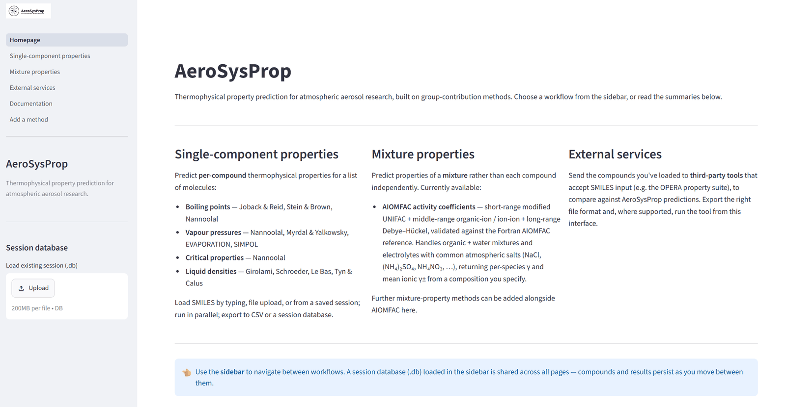

<p align="center">
  <picture>
    <source media="(prefers-color-scheme: dark)" srcset="docs/images/logo-dark.png">
    
  </picture>
</p>

# AeroSysProp

[](https://doi.org/10.5281/zenodo.24013620)

A Python library for predicting thermophysical properties of organic molecules relevant to atmospheric aerosol research. Given a SMILES string, AeroSysProp applies a range of published group-contribution methods to estimate boiling points, vapour pressures, critical properties, and liquid densities. For mixtures, it also provides AIOMFAC activity coefficients (short-range modified UNIFAC, middle-range organic–ion and ion–ion, and long-range Debye–Hückel), validated against the Fortran AIOMFAC reference for >1500 atmospheric and laboratory compounds and the common atmospheric salts (NaCl, Na₂SO₄, (NH₄)₂SO₄, NH₄NO₃, KCl, NH₄Cl, …).

---

## Table of Contents

- [Background](#background)
- [Directory structure](#directory-structure)
- [Installation](#installation)
- [Quick start](#quick-start)
- [Loading SMILES from files](#loading-smiles-from-files)
- [Available methods](#available-methods)
- [Activity coefficients](#activity-coefficients)
- [Method cards and provenance](#method-cards-and-provenance)
- [Web interface](#web-interface)
- [Use with AI agents (MCP)](#use-with-ai-agents-mcp)
- [Use in numerical simulations](#use-in-numerical-simulations)
- [Running the tests](#running-the-tests)
- [Docker](#docker)
- [Contributing](#contributing)
- [Citation](#citation)
- [License](#license)
- [Contact](#contact)

---

## Background

AeroSysProp builds on the earlier [UManSysProp](https://github.com/loftytopping/UManSysProp_pub) package. Its core purpose is to take a molecular structure (supplied as a SMILES string) and return property estimates using well-established group-contribution methods from the atmospheric chemistry literature. These estimates feed directly into aerosol partitioning models, droplet growth calculations, and related applications.

Molecular substructure matching is performed with [RDKit](https://www.rdkit.org/). Choice of predictive methods, and any modifications to them, is governed by the project team; the aim is always to provide a faithful implementation of the published technique, with any deviations clearly documented.

---

## Directory structure

```
AeroSysProp/
├── environment.yml                  # Conda environment definition
├── aerosysprop/
│   ├── __init__.py
│   ├── groups.py                    # SMARTS-based group counting and aggregation
│   ├── io.py                        # SMILES loaders: text, SQLite, SDF
│   ├── db.py                        # Session database (compounds, results, mixtures)
│   ├── diagnostics.py               # Input pre-flight checks (matcher coverage, parameters, composition)
│   ├── fingerprints.py              # Batch SMARTS-hit matrix for SMILES inspection
│   ├── molar_volumes.py             # Molar volume helpers used by density methods
│   ├── app.py                       # Streamlit app — navigation router (st.navigation)
│   ├── _ui.py                       # Shared Streamlit UI helpers used by the views
│   ├── api.py                       # Agent-facing API: plain JSON in and out, read-only
│   ├── mcp_server.py                # MCP server for AI agents (aerosysprop-mcp)
│   ├── agent_guide.md               # Guidance for agents using the MCP server
│   ├── views/                       # Streamlit multipage app pages
│   │   ├── home.py                  # Homepage / landing
│   │   ├── single_component.py      # Per-compound property prediction
│   │   ├── mixture.py               # Mixture properties (AIOMFAC activity coefficients)
│   │   └── external_services.py     # Third-party tool integrations (OPERA, …)
│   ├── data/                        # Group-contribution parameters and SMARTS patterns
│   │   ├── __init__.py              # Loads all .data, .smarts, and .matrix files at import
│   │   ├── *.smarts                 # SMARTS patterns for each method's functional groups
│   │   ├── *.data                   # Group contribution coefficients
│   │   └── *.matrix                 # Interaction matrices (Nannoolal, AIOMFAC SR/MR)
│   ├── methods/
│   │   ├── boiling_points.py        # Joback & Reid, Stein & Brown, Nannoolal
│   │   ├── vapour_pressures.py      # Nannoolal, Myrdal & Yalkowsky, EVAPORATION, SIMPOL
│   │   ├── critical_properties.py   # Joback & Reid, Nannoolal
│   │   ├── liquid_densities.py      # Girolami, Schroeder, Le Bas, Tyn & Calus
│   │   ├── activity_coefficients.py # AIOMFAC SR + MR + LR (mixtures, electrolytes)
│   │   └── activity_coefficients.md # AIOMFAC reference documentation
│   ├── examples/
│   │   ├── Pure_component_properties_example.py   # Worked example script
│   │   └── test.prop                              # Example SMILES input file
│   ├── tests/                       # pytest suite (3600+ tests)
│   └── Docker/
│       └── Dockerfile
```

---

## Installation

### 1. Clone the repository

```bash
git clone https://github.com/environmental-ai-systems/AeroSysProp.git
cd AeroSysProp
```

### 2. Create the conda environment

The environment file installs Python, RDKit, NumPy, tqdm, and pytest:

```bash
conda env create -f environment.yml
conda activate AeroSysProp
```

### 3. Verify the installation

```bash
python -c "from aerosysprop.methods import boiling_points; print('OK')"
```

---

## Quick start

All methods accept an [RDKit](https://www.rdkit.org/) molecule object. The typical workflow is:

```python
from rdkit import Chem
from aerosysprop.methods import boiling_points, vapour_pressures, critical_properties, liquid_densities

# 1. Parse a SMILES string into an RDKit molecule
mol = Chem.MolFromSmiles('CC(O)OO')   # methyl hydroperoxide

# 2. Boiling point estimates (K)
bp_joback    = boiling_points.joback_and_reid(mol)
bp_stein     = boiling_points.stein_and_brown(mol)
bp_nannoolal = boiling_points.nannoolal(mol)

print(f'Joback & Reid:  {bp_joback:.2f} K')
print(f'Stein & Brown:  {bp_stein:.2f} K')
print(f'Nannoolal:      {bp_nannoolal:.2f} K')

# 3. Vapour pressure estimates (log10 atm) at 298.15 K
temperature = 298.15

vp_nannoolal = vapour_pressures.nannoolal(mol, temperature, bp_nannoolal)
vp_evap      = vapour_pressures.evaporation(mol, temperature)
vp_simpol    = vapour_pressures.simpol(mol, temperature)

print(f'Nannoolal VP:   {vp_nannoolal:.4f} log10(atm)')
print(f'EVAPORATION VP: {vp_evap:.4f} log10(atm)')
print(f'SIMPOL VP:      {vp_simpol:.4f} log10(atm)')

# 4. Critical properties (needed by some density methods)
cp = critical_properties.nannoolal(mol, bp_nannoolal)
print(f'Critical T:     {cp.temperature:.2f} K')
print(f'Critical P:     {cp.pressure:.4f} bar')

# 5. Liquid density (g/cc) at 298.15 K
density = liquid_densities.schroeder(mol, temperature, cp)
print(f'Schroeder rho:  {density.real:.4f} g/cc')
```

---

## Loading SMILES from files

`aerosysprop.io` provides loaders that read SMILES strings from common file formats and return `(name, mol)` pairs ready to pass directly into the property methods. Invalid SMILES are skipped with a warning rather than raising an exception.

### Plain text file

The simplest format is one SMILES per line:

```
COO
C(O)CO
CC(C)=O
CC(=O)O
```

Or tab-separated with a name column:

```
methyl_hydroperoxide	COO
ethylene_glycol	C(O)CO
acetone	CC(C)=O
```

```python
from aerosysprop.io import read_smiles_txt
from aerosysprop.methods import boiling_points

# One SMILES per line
mols = read_smiles_txt('compounds.txt', smiles_col=0)

# Name in column 0, SMILES in column 1
mols = read_smiles_txt('compounds.txt', smiles_col=1, name_col=0)

# AeroSysProp default: index\tSMILES (e.g. aerosysprop/examples/test.prop)
mols = read_smiles_txt('test.prop')   # smiles_col=1 is the default

for name, mol in mols:
    bp = boiling_points.nannoolal(mol)
    print(f'{name:30s}  Tb = {bp:.2f} K')
```

Lines beginning with `#` are treated as comments and skipped. Empty lines are also ignored.

### SQLite database

```python
from aerosysprop.io import read_smiles_db, create_smiles_db

# Read from the default schema (table='compounds', columns 'name' and 'smiles')
mols = read_smiles_db('mydata.db')

# Read from a database with a different schema
mols = read_smiles_db('mydb.db', table='molecules', smiles_col='smi', name_col='compound_id')

# Create (or extend) a database
create_smiles_db('mydata.db', [('ethanol', 'CCO'), ('acetone', 'CC(C)=O')])
```

The default SQLite schema created by `create_smiles_db` is:

```sql
CREATE TABLE compounds (
    id      INTEGER PRIMARY KEY AUTOINCREMENT,
    name    TEXT,
    smiles  TEXT NOT NULL
);
```

Calling `create_smiles_db` on an existing database appends rows without duplicating the table, making it suitable for a companion storage tool that accumulates compounds over time.

### SDF file

```python
from aerosysprop.io import read_smiles_sdf

# Name taken from the title line of each record
mols = read_smiles_sdf('compounds.sdf')

# Name taken from a specific SD tag (e.g. from a PubChem download)
mols = read_smiles_sdf('pubchem.sdf', name_property='PUBCHEM_COMPOUND_CID')
```

If a record has no title line, a sequential fallback name (`mol_1`, `mol_2`, …) is used automatically.

---

## Available methods

### Boiling points — `aerosysprop.methods.boiling_points`

| Function | Method | Returns |
|---|---|---|
| `joback_and_reid(mol)` | Joback & Reid (1987) | K |
| `stein_and_brown(mol)` | Stein & Brown (1994) | K |
| `nannoolal(mol)` | Nannoolal *et al.* (2004) | K |

### Vapour pressures — `aerosysprop.methods.vapour_pressures`

All functions return **log₁₀(P / atm)**. `T` is temperature in K.

| Function | Method | Requires boiling point? |
|---|---|---|
| `nannoolal(mol, T, bp)` | Nannoolal *et al.* (2008) | Yes |
| `myrdal_and_yalkowsky(mol, T, bp)` | Myrdal & Yalkowsky (1997) | Yes |
| `evaporation(mol, T)` | EVAPORATION (Compernolle *et al.*, 2011) | No |
| `evaporation2(mol, T)` | EVAPORATION parameter set 2 (revised alcohol terms; the default in the app and API) | No |
| `simpol(mol, T)` | SIMPOL.1 (Pankow & Asher, 2008) | No |

### Critical properties — `aerosysprop.methods.critical_properties`

Both functions return a named tuple `CriticalProperties(temperature, pressure, volume, compressibility)`.

| Function | Method |
|---|---|
| `joback_and_reid(mol, bp)` | Joback & Reid (1987) |
| `nannoolal(mol, bp)` | Nannoolal *et al.* (2004) |

### Liquid densities — `aerosysprop.methods.liquid_densities`

All functions return density in **g/cc**.

| Function | Method | Requires critical properties? |
|---|---|---|
| `girolami(mol)` | Girolami (1994) | No |
| `schroeder(mol, T, cp)` | Schroeder | Yes |
| `le_bas(mol, T, cp)` | Le Bas | Yes |
| `tyn_and_calus(mol, T, cp)` | Tyn & Calus | Yes |

---

## Activity coefficients

`aerosysprop.methods.activity_coefficients` implements the **short-range
(SR) part** of the AIOMFAC model — a modified UNIFAC formulation that
predicts mole-fraction-based activity coefficients γᵢ for non-electrolyte
mixtures (organic + water) from SMILES strings.

| Function / class | Returns | Use for |
|---|---|---|
| `aiomfac_sr_from_smiles(smiles, x, T_K)` | `ndarray` of γᵢ | Non-electrolyte one-shot SMILES API (SR only) |
| `AIOMFAC_SR(components)` | object | Cached non-electrolyte system |
| `aiomfac_from_smiles(smiles, salts, mass_fractions, T_K)` | `AIOMFACResult` | Full SR+MR+LR with electrolytes |
| `AIOMFAC(neutrals, salts=None)` | object | Cached full system (works for non-electrolyte too) |

```python
# Non-electrolyte: 50:50 water-ethanol at 25 °C
from aerosysprop.methods.activity_coefficients import aiomfac_sr_from_smiles
print(aiomfac_sr_from_smiles(['O', 'CCO'], [0.5, 0.5], 298.15))
# [1.26196 1.18692]

# Electrolyte: water + ethanol + NaCl at mass fractions [0.75, 0.20, 0.05]
from aerosysprop.methods.activity_coefficients import aiomfac_from_smiles
result = aiomfac_from_smiles(['O', 'CCO'], ['NaCl'], [0.75, 0.20, 0.05], 298.15)
print(result.gamma_neutral)   # mole-fraction basis γ for water, ethanol
print(result.gamma_mean)      # mean ionic γ_± for NaCl (molality basis)
```

Outputs match the Fortran AIOMFAC reference
([github.com/andizuend/AIOMFAC](https://github.com/andizuend/AIOMFAC)) to
~5 × 10⁻⁵ relative across **1520 SR regression fixtures** spanning 30
functional-group main groups (including 1432 unique-signature compounds
from the [Master Chemical Mechanism](https://mcm.york.ac.uk/MCM/) v3.3.1)
plus **43 electrolyte fixtures** covering every common atmospheric salt
(NaCl, KCl, NH₄Cl, NaNO₃, NH₄NO₃, Na₂SO₄, (NH₄)₂SO₄, MgCl₂, CaCl₂, MgSO₄,
HCl, HNO₃), multi-salt mixtures with 2-4 salts and full cation/anion
cross-coupling, multi-organic + multi-salt cases (urban aerosol, marine
SOA + sea-salt, biomass-burning, α-pinene SOA proxies), divalent cations,
and edge concentrations from 10⁻⁴ to saturation.

### Diagnostics

Every aerosysprop method that consumes a SMILES has silent failure modes
(matcher gaps for missing SMARTS, AIOMFAC 281-285 extension subgroups,
mass fractions not summing to 1, missing MR parameter pairs, …). The
`aerosysprop.diagnostics` module flags every known issue class. The
AIOMFAC entry points accept a `strict='warn' | 'raise' | 'silent'`
argument (default `'warn'`); for any method, you can also pre-flight a
SMILES (or full mixture) without running the calculation:

```python
from aerosysprop.diagnostics import diagnose, diagnose_aiomfac
from aerosysprop.methods import boiling_points

report = diagnose(boiling_points.nannoolal, 'CS(=O)C')   # DMSO
report.is_ok            # False - S=O atoms unmatched by Nannoolal SMARTS

report = diagnose_aiomfac(
    smiles=['O', 'Cc1ccccc1'], salts=['NH42SO4'],
    mass_fractions=[0.85, 0.10, 0.05], T_K=298.15,
)
report.has_errors       # True - main_group 4 lacks SO4-- parameter
```

For full theory, API reference, validation methodology, compound coverage,
known limitations, citations, and roadmap (the peroxy/nitrate SMARTS
extension is still pending), see
[`aerosysprop/methods/activity_coefficients.md`](aerosysprop/methods/activity_coefficients.md).

### SMARTS hit matrix for a batch of SMILES

The `aerosysprop.fingerprints` module returns a hit-count matrix for any
registered SMARTS method:

```python
from aerosysprop.fingerprints import smarts_hits, available_methods

available_methods()
# ['aiomfac', 'aiomfac_hctail', 'aiomfac_ions', 'simpol', 'nannoolal_primary',
#  'nannoolal_secondary', 'evaporation', 'evaporation2', 'stein_and_brown',
#  'girolami', 'le_bas', 'schroeder', 'composition', 'moller', 'fp4', 'maccs']

df = smarts_hits(
    smiles=['O', 'CCO', 'OCC(O)CO', 'Cc1ccccc1'],
    method='aiomfac',
    drop_zero_columns=True,
)
#             1   2   3   9   11  14  16
# O           0   0   0   0   0   0   1
# CCO         1   1   0   0   0   1   0
# OCC(O)CO    0   2   1   0   0   3   0
# Cc1ccccc1   1   0   0   5   1   0   0
```

A `smarts_hits_all(smiles, methods=[...])` companion returns a single
DataFrame with a `MultiIndex(method, id)` for side-by-side comparison
across multiple SMARTS sets.

---

## Running the tests

### Property regression tests

The regression test suite checks all methods against pre-computed reference values across 21 representative atmospheric compounds:

```bash
conda activate AeroSysProp
pytest aerosysprop/tests/test_properties.py -v
```

Expected output: **399 passed**.

### IO loader tests

```bash
pytest aerosysprop/tests/test_io.py -v
```

Expected output: **16 passed**.

### Activity-coefficient regression tests

```bash
pytest aerosysprop/tests/test_activity_coefficients.py \
       aerosysprop/tests/test_activity_coefficients_electrolytes.py
```

Expected output: **3130 passed in ~10 s** (3042 SR + 88 electrolyte).
The electrolyte suite exercises the full SR + MR + LR pipeline across
43 atmospheric-salt and multi-component mixtures, including realistic
SOA + inorganic aerosol proxies. To refresh the underlying
fixtures against the Fortran AIOMFAC reference, see
[`aerosysprop/methods/activity_coefficients.md`](aerosysprop/methods/activity_coefficients.md#validation-methodology).

### Run all tests

```bash
pytest aerosysprop/tests/ -v
```

### Regenerating reference values

If you intentionally change a method's implementation, regenerate `fixtures.json` and commit it alongside your code change:

```bash
python aerosysprop/tests/generate_fixtures.py
```

---

## Method cards and provenance

Every method has a versioned **method card** in
[`aerosysprop/methods/cards/`](aerosysprop/methods/cards/). The card records
the method's references and publication status, the parameter files it
uses with a SHA-256 fingerprint of each, documented departures from the
source papers, known limitations, validation and review state. A
prediction is identified by three things: the method ID, the parameter set
version, and the software version with its git commit.

Continuous integration checks every parameter file against its card, so a
change to a SMARTS pattern or coefficient fails the build until the card is
updated:

```bash
python -m aerosysprop.method_cards            # check every card
```

Batch runs through the agent API write a run folder containing the
results, the diagnostics, a provenance manifest (`run.json`) and
[RO-Crate](https://www.researchobject.org/ro-crate/) metadata, so a run can
be archived or deposited as it stands. The process for proposing and
reviewing method changes is set out in
[`METHODS_GOVERNANCE.md`](METHODS_GOVERNANCE.md).

---

## Web interface

AeroSysProp ships a [Streamlit](https://streamlit.io/) multipage app. There are
two ways to run it — pick whichever suits you:

**A. Your own Python environment** (primary path)

Using the conda environment:

```bash
conda activate AeroSysProp
streamlit run aerosysprop/app.py
```

…or any plain virtual environment — the runtime dependencies are declared in
`pyproject.toml`, so an editable install pulls them in:

```bash
pip install -e ".[ui]"
streamlit run aerosysprop/app.py
```

**B. Docker** (optional, one command)

```bash
docker compose up --build app      # → http://localhost:8501
```

See the [Docker](#docker) section for details. Either way the app opens at
<http://localhost:8501>.



The sidebar navigates between three workflows, reflecting the fact that
single-component and mixture predictions have fundamentally different
inputs:

| Page | Workflow | Input | Output |
|---|---|---|---|
| **Single-component properties** | Predict each compound independently | A list of SMILES (typed, file upload, or session) | Boiling points, vapour pressures, critical properties, liquid densities — one row per compound |
| **Mixture properties** | One coupled mixture calculation (currently AIOMFAC) | Neutral components (SMILES) + salts + a mass-fraction composition + temperature | Per-species activity coefficients and mean ionic γ± for the mixture |
| **External services** | Hand compounds to third-party tools | The compounds loaded on the single-component page | Exported files (and, where supported, direct invocation) for tools like OPERA |

The single-component page's **boiling-point input** sits with the methods
(not under generic settings) because it is an input dependency of the
vapour-pressure, critical-property, and density methods. It is a
multi-select: pick one source for the usual behaviour, or several to
compare the sensitivity of the dependent predictions to the
boiling-point choice — each dependent column is then reported once per
source (e.g. `vp_nannoolal_log10atm__bpStein`).

Some methods have more than one **parameter set**: the same equations
with different group definitions. EVAPORATION has two. Set 1 is the
original port, with an MCM-style enol term; set 2 (the default) revises
the alcohol terms to match the published method. Tick EVAPORATION and
choose one or both sets underneath it. The column always names the set
(`vp_evaporation_log10atm__set2`), so results from different sets can't
be confused. The sets give the same value for most molecules; on the MCM
they differ for 91 of 5,809 species: 78 enols, by about 0.9 log units,
and 13 alpha-hydroxy acids, by about 0.25 log units (see
`METHODS_GOVERNANCE.md`; the second looks like an unintended side effect).
From Python, pass `parameter_sets={'vp_evaporation': [1, 2]}` to
`run_all`; through the agent API, request `"vp_evaporation@1"`. The old
method ID `vp_evaporation2` still works as an alias for set 2 but is
deprecated. Session databases saved before this change hold columns
named `vp_evaporation_log10atm` (set 1) and `vp_evaporation2_log10atm`
(set 2).

A **session database** (`.db`) loaded in the sidebar is shared across
all three pages — compounds, single-component results, and saved
mixture calculations persist as you move between them. Both
single-component results and mixture activity-coefficient calculations
can be saved to and reloaded from the same `.db` file, or downloaded as
CSV.

The **Mixture activity coefficients** page accepts SMILES the same way
as the single-component page (type, upload a file, or reload from a
saved session), lets you pick inorganic salts from the AIOMFAC catalog,
and surfaces input diagnostics (matcher gaps, missing interaction
parameters, out-of-range concentrations) inline with the results.

---

## Use with AI agents (MCP)

AeroSysProp includes a [Model Context Protocol](https://modelcontextprotocol.io) (MCP) server, so AI agents such as Claude Desktop, Claude Code or a local model with an MCP-capable client can call it directly. The agent sees a small set of documented tools and gets plain JSON back, with units in the field names and the relevant diagnostics attached to every value.

Install the optional dependency (Python 3.10 or later):

```bash
pip install -e ".[mcp]"
```

This provides the `aerosysprop-mcp` command. By default it speaks MCP over stdio, which is what desktop agents expect; `aerosysprop-mcp --http --port 8765` serves Streamable HTTP instead.

| Tool | Purpose |
|---|---|
| `list_methods` | Method IDs, units, output columns and dependencies |
| `list_salts` | Salts supported by AIOMFAC, with their ions |
| `predict_properties` | Boiling point, vapour pressure, critical properties and density for up to 1000 SMILES |
| `diagnose_smiles` | SMILES validity and per-method group coverage, without computing anything |
| `activity_coefficients` | AIOMFAC activity coefficients for water/organic/salt mixtures |
| `list_data_files`, `load_smiles_file` | Read molecules from files in the data directory |
| `read_session_database` | Read results saved by the web app |
| `opera_predict` | OPERA QSAR predictions, when the OPERA container is running |
| `start_batch_run`, `batch_run_status` | Large runs (up to 100,000 molecules) written to a run folder, with a summary for the agent |
| `read_batch_results`, `list_batch_runs` | Read slices of a run (flagged molecules, largest disagreements) and list earlier runs |

The server **never overwrites, deletes, or writes to a session database**. File reading is confined to the directory named by `AEROSYSPROP_DATA_DIR`, and session databases are opened in SQLite read-only mode. The only thing it writes is a batch run: each run creates a new folder inside `AEROSYSPROP_OUTPUT_DIR` holding `results.csv`, `diagnostics.csv`, `run.json` (a provenance manifest recording the request, each method's version label, the software version and a SHA-256 fingerprint of every output file) and `ro-crate-metadata.json`, the same provenance as an [RO-Crate](https://www.researchobject.org/ro-crate/) following the [Process Run Crate](https://www.researchobject.org/workflow-run-crate/) profile, so a run folder can be archived or deposited (for example on Zenodo) as it stands. Either feature is disabled if its variable is not set. The full MCM v3.3.1 (5,809 species, all methods) runs in about 40 s on 4 cores.

**The run folder is the result; an agent's account of it is a guide to the result.** An agent sees a compact summary rather than every row. The summary therefore separates statistics for *clean* molecules (closed-shell, no method flagged) from those for all molecules, carries a coverage statement (for the MCM: 37% clean, 38% radicals), and lists caveats and reporting requirements that agents are instructed to pass on. Specific molecules are always looked up by name or SMILES rather than inferred. Note that this only governs what agents can do *through the server*; an agent that also has shell access is controlled by that agent's own permission settings.

**Guidance level.** `AEROSYSPROP_GUIDANCE=bare` serves the tools without their documentation for agents, while every value stays identical. It exists for research on what that documentation contributes, described in [Evaluating AI agents that use AeroSysProp](docs/agent-evaluation.md). For normal use leave it unset.

**Claude Desktop**: add to `claude_desktop_config.json` (use the full path to the command in your environment, e.g. from `which aerosysprop-mcp`):

```json
{
  "mcpServers": {
    "aerosysprop": {
      "command": "/path/to/envs/AeroSysProp/bin/aerosysprop-mcp",
      "env": {
        "AEROSYSPROP_DATA_DIR": "/path/to/your/smiles/files",
        "AEROSYSPROP_OUTPUT_DIR": "/path/to/aerosysprop-runs"
      }
    }
  }
}
```

**Claude Code**:

```bash
claude mcp add aerosysprop -e AEROSYSPROP_DATA_DIR=/path/to/your/smiles/files \
  -e AEROSYSPROP_OUTPUT_DIR=/path/to/aerosysprop-runs -- aerosysprop-mcp
```

**Trying it without an agent**: the MCP Inspector lets you call each tool by hand:

```bash
npx @modelcontextprotocol/inspector aerosysprop-mcp
```

The same functions are available directly in Python through `aerosysprop.api`, which the server wraps; every function takes and returns plain JSON-compatible values. Guidance written for agents (units, how to read diagnostics, when to compare methods) is in [`aerosysprop/agent_guide.md`](aerosysprop/agent_guide.md) and is also served to agents as the resource `aerosysprop://guide`.

---

## Use in numerical simulations

AeroSysProp is a library, not just the bundled Streamlit app. The
methods are designed to be called directly from numerical simulations —
partitioning solvers, Monte Carlo, droplet growth integrators,
equilibrium iterators, parameter-fitting pipelines — that need to
evaluate thermodynamic / property functions tens of thousands to
millions of times per simulation.

### Throughput

All methods are written to amortise SMILES parsing, SMARTS matching,
and parameter-table assembly across repeated calls with the same set
of compounds (the typical simulation pattern: compounds are fixed,
composition and temperature vary). Concrete numbers on a single
M-series core for a 10-organic + 1-salt mixture:

| API | Per-call time | Calls per second |
|---|---|---|
| ``aiomfac_from_smiles(..., strict='warn')`` (default, full SR+MR+LR) | ~0.10 ms | ~10 000 |
| ``aiomfac_sr_from_smiles(...)`` (non-electrolyte SR-only) | ~0.05 ms | ~20 000 |
| ``vapour_pressures.simpol(mol, T)`` (one organic) | ~0.01 ms | ~100 000 |
| ``boiling_points.nannoolal(mol)`` | ~0.05 ms | ~20 000 |

For 1 million AIOMFAC calls, expect ~100 seconds of wall time at the
default settings.

### Recommended integration patterns

**1. Default — SMILES-driven, automatic caching.** Pass the same
SMILES list on every call; aerosysprop transparently caches the
constructed `AIOMFAC` system, the matcher decomposition for each
SMILES, and the diagnostic pre-flight analysis. No setup code
required.

```python
from aerosysprop.methods.activity_coefficients import aiomfac_from_smiles

# In a tight loop -- same SMILES every call, varying composition
for x in composition_grid:
    result = aiomfac_from_smiles(
        smiles=smiles, salts=salts,
        mass_fractions=x, T_K=T,
    )
    gamma = result.gamma_neutral
    # Issues (matcher gaps, missing parameters, edge concentrations) are
    # surfaced as warnings.warn at the default strict='warn' setting and
    # also attached at result.diagnostics for after-the-fact inspection.
```

**2. Hot path — skip the diagnostic memoisation.** ~10% faster than
the default once you've pre-validated your inputs.

```python
for x in composition_grid:
    result = aiomfac_from_smiles(..., strict='silent')
```

**3. Explicit system class — most control.** Build the `AIOMFAC`
system once, reuse the same instance across all calls. Useful when
the simulation framework owns the lifecycle of the mixture state
and wants the SMILES → subgroup conversion to happen explicitly:

```python
from aerosysprop.methods.activity_coefficients import AIOMFAC
from aerosysprop import groups
from rdkit import Chem

neutrals = [groups.aiomfac(Chem.MolFromSmiles(s)) for s in smiles]
system   = AIOMFAC(neutrals, salts=['NaCl'])

for x in composition_grid:
    result = system.gamma(x, 298.15)
```

### Cache controls

To keep repeated calls fast, AeroSysProp remembers work it has already done for a given set of SMILES. It keeps two of these stores, or caches:

- the AIOMFAC system built from a list of SMILES, for up to 128 different lists (and another 128 for the short-range-only version), and
- the diagnostic check for each SMILES, for up to 4,096 molecules.

When a cache is full, the entry used least recently is dropped, so memory stays at a few MB and in normal use you never need to touch them. There are two reasons you might: to confirm that caching is working in your loop, or to start afresh, for example after reloading the SMARTS pattern files during a session.

```python
from aerosysprop.methods.activity_coefficients import system_cache_info, clear_system_cache
from aerosysprop.diagnostics import diagnostic_cache_info, clear_diagnostic_cache

full, short_range = system_cache_info()   # one record for each kind of AIOMFAC system
print(full.hits, full.misses, full.currsize, full.maxsize)
print(diagnostic_cache_info())            # the same four numbers for the per-SMILES checks

clear_system_cache()       # forget the stored AIOMFAC systems
clear_diagnostic_cache()   # forget the stored per-SMILES checks
```

A hit is a call that reused stored work and a miss is one that had to do the work. In a loop over a fixed SMILES list, the full-system cache should show one miss for the list and a hit for every call after that.

### Surfacing issues without crashing the loop

The default `strict='warn'` issues `warnings.warn(...)` for any
matcher truncation, missing parameter, or out-of-range concentration
the framework detects, then proceeds with the calculation. Embed
that in your standard Python warning capture for logging:

```python
import warnings
with warnings.catch_warnings(record=True) as collected:
    warnings.simplefilter('always')
    result = aiomfac_from_smiles(...)
    for w in collected:
        logger.warning(str(w.message))
```

To turn issues into exceptions (so a misconfigured input aborts the
simulation rather than silently producing wrong values), pass
`strict='raise'`. To skip the pre-flight entirely, pass
`strict='silent'`.

### Thread safety

Both caches use Python's `functools.lru_cache` which is thread-safe
in CPython. The `AIOMFAC` and `AIOMFAC_SR` classes are stateless
between calls except for an internal per-instance temperature cache,
which is fine to share across threads (worst case: a redundant
recomputation on first use). All numpy operations are GIL-free
on numpy 2.x.

### Pre-flighting inputs

For framework integrators who want to validate inputs before the
main simulation loop starts (e.g., at config-load time), the
diagnostic functions run without computing gammas:

```python
from aerosysprop.diagnostics import diagnose_aiomfac

report = diagnose_aiomfac(smiles, salts, mass_fractions, T_K)
if report.has_errors:
    raise SystemExit(report.summary())
for warning in report.warnings:
    logger.warning('%s: %s', warning.code, warning.message)
```

A `smarts_hits()` matrix is also available from the
`aerosysprop.fingerprints` module for batch SMILES inspection. See
[`aerosysprop/methods/activity_coefficients.md`](aerosysprop/methods/activity_coefficients.md#diagnostics)
for the full diagnostic and fingerprint API.

---

## Docker

Docker is an **optional** way to run the web app — running it in your own Python
environment (see [Web interface](#web-interface)) is fully supported and remains
the primary path. Use Docker when you want a one-command, dependency-free launch.

This builds a small, self-contained image (Python + RDKit + Streamlit installed
from PyPI wheels — no conda, no GitHub clone) and serves the app on port 8501.
The image builds natively for your machine (`arm64` on Apple Silicon, `amd64` on
Intel).

**Start** (from the repository root):

```bash
docker compose up --build app      # build + run in the foreground; Ctrl-C to stop
# or run it in the background:
docker compose up -d --build app   # → http://localhost:8501
docker compose logs -f app         # follow the logs of a background container
```

**Stop / close** the app:

```bash
docker compose down                # stop AND remove the container + network
# or, to stop without removing (keeps it for a quick restart):
docker compose stop app
docker compose start app           # start it again later
```

`docker compose down` is the clean shutdown — it stops the container and removes
it along with the compose network, leaving only the built image cached for next
time. To reclaim that image too: `docker image rm aerosysprop-app:latest`.

See [`aerosysprop/Docker/README.md`](aerosysprop/Docker/README.md) for details.

### Optional external tools (OPERA)

Third-party predictive tools such as [OPERA](https://github.com/NIEHS/OPERA) are
**optional, externally-managed** integrations — AeroSysProp never requires them.
OPERA runs as a *separate* container (or wherever you already have it installed),
networked to the app, so the app stays native while OPERA runs as its x86_64
image. If you already have OPERA you don't need our container at all; if you don't,
the `--profile opera` container builds it (MATLAB Runtime bundled) and, on Apple
Silicon, Docker + Rosetta handle the x86 emulation automatically. The full
decision tree (already-installed vs. containerised, and the Rosetta story) is in
[`opera/EXTERNAL_TOOLS.md`](opera/EXTERNAL_TOOLS.md). Service setup, **calling the
service from another Python application** (synchronous and asynchronous HTTP), the
result-reliability columns (`AD` / `Conf_index`) and OPERA's methodology
references are in [`opera/README.md`](opera/README.md).

---

## Contributing

Contributions are welcome. Please open an issue before submitting a pull request so that proposed method changes can be discussed with the project team. Incorrect or missing group assignments can be reported with the *group assignment* issue template, and changes to a method's parameters follow the process in [`METHODS_GOVERNANCE.md`](METHODS_GOVERNANCE.md).

See [`CONTRIBUTING.md`](CONTRIBUTING.md) for how to report problems, check methods against their sources and submit changes. Everyone taking part is expected to follow the [code of conduct](CODE_OF_CONDUCT.md). Any modification to an existing method should be accompanied by:

1. A clear description of what differs from the published technique.
2. Updated reference values (`fixtures.json`) generated by running `generate_fixtures.py`.
3. Passing tests (`pytest aerosysprop/tests/`).

---

## Citation

If you use AeroSysProp in published work, please cite the software using the metadata in [`CITATION.cff`](CITATION.cff) (GitHub's *Cite this repository* button gives it in APA and BibTeX), quoting the version you used. Please also cite the original papers for the methods you use, listed in the tables above, in each method card and in [`THIRD_PARTY.md`](THIRD_PARTY.md).

AeroSysProp descends from UManSysProp:

Topping, D., Barley, M., Bane, M. K., Higham, N., Aumont, B., Dingle, N., and McFiggans, G.: UManSysProp v1.0: an online and open-source facility for molecular property prediction and atmospheric aerosol calculations, Geosci. Model Dev., 9, 899-914, https://doi.org/10.5194/gmd-9-899-2016, 2016.

Changes between versions are recorded in [`CHANGELOG.md`](CHANGELOG.md).

---

## License

AeroSysProp is distributed under the GNU General Public License v3 or later. See [LICENSE](LICENSE) for details, and [`THIRD_PARTY.md`](THIRD_PARTY.md) for material from other sources and its licences.

---

## Contact

David Topping — david.topping@manchester.ac.uk  
University of Manchester
